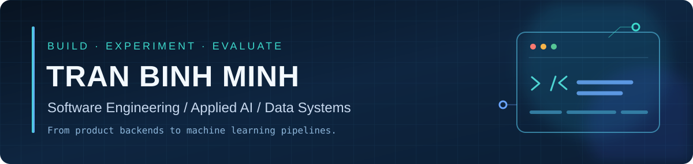

<div align="center">
  
  <br/>
  <a href="https://readme-typing-svg.demolab.com">
    
  </a>
  <br/><br/>
  <a href="#-featured-projects"></a>
  <a href="#-engineering-toolbox"></a>
  <a href="mailto:binhminh51107@gmail.com"></a>
</div>

## 👋 Who I am

I'm **Minh**, a software development graduate and an Information Technology bachelor's student at **UIT (VNU-HCM), Vietnam**.

I started by building websites, e-commerce platforms, authentication systems, databases, and real-time backends. Then I became interested in what happens when **software engineering meets AI**: RAG applications, data acquisition and retrieval, automated media workflows, computer vision, model evaluation, and data quality.

**My direction is expanding — not replacing — my software background.** I enjoy the whole chain: understanding a problem, designing its architecture, writing the code, working with data, measuring behavior, and investigating failures.

- 🏢 **Experience:** Software Development Intern at Dragonaddon (Laravel / Vue / business systems); robotics data annotation and QC work at VinRobotics.
- 🎓 **Education:** FPT Polytechnic — Software Development (2026); UIT — B.Sc. Information Technology (*in progress*).
- 🧠 **Practical AI training:** VinUniversity / Vingroup **AI in Action, Cohort 4** — detection, tracking, segmentation, LiDAR/3D workflows and model evaluation.
- 🏅 **Academic recognition:** Outstanding Student in Software Development and graduation project recognition at FPT Polytechnic.
- 🎯 **Open to:** Software Engineering, Applied AI, Computer Vision, and Data Engineering opportunities.

---

## 🧰 Engineering toolbox

*Tools and concepts I've worked with or studied in projects and labs — not a claim of equal expertise in every item.*

| Area | Technologies & experience |
|---|---|
| **Languages** | `Java` · `Python` · `TypeScript` · `JavaScript` · `PHP` · `SQL` |
| **Backend & architecture** | `Spring Boot` · `NestJS` · `Laravel` · `REST APIs` · `JWT / OAuth2` · `WebSocket / STOMP` · `RBAC` · `Cron / Background Jobs` |
| **Frontend & design** | `Vue 3` · `React` · `Inertia.js` · `Tailwind CSS` · `Vuetify` · responsive/mobile-first UI · grid systems · component-based UI/UX |
| **AI integration & LLM apps** | `RAG` · `pgvector` · `LangChain / LangGraph` · `Cohere Reranking` · `OpenAI / Gemini / Groq APIs` · `Whisper (STT)` · `TTS` |
| **Computer vision & ML** | `PyTorch (practical use)` · `Ultralytics YOLO` · `OpenCV` · `ByteTrack` · detection · segmentation · multi-object tracking · fine-tuning · evaluation |
| **Data & databases** | `PostgreSQL` · `MySQL` · `SQL Server` · `SQLite` · `Redis` (caching/locking) · hybrid search (`Dense + BM25 + RRF`) · annotation/QC · COCO/YOLO/MOT formats |
| **Infra & engineering tools** | `Git / GitHub` · `Docker / Compose` · `GitHub Actions` · `Google Colab` · `FFmpeg` · `Prisma` · `Selenium` |

<div align="center">

</div>

---

## 🚀 Featured projects

### 🧱 Software engineering & full-stack products

| Project | What I built / explored |
|---|---|
| **[MindRevol — Journey & Social Platform](https://github.com/minhtb51107/mindrevol-backend)** | A social-product MVP with **Java / Spring Boot**, authentication (**JWT / OAuth2**), PostgreSQL, Redis, and real-time messaging (**WebSocket / STOMP**). My software-engineering foundation: domain modules, APIs, state, and deployment. |
| **[Spring Electro Store](https://github.com/minhtb51107/spring-electro-store)** | An e-commerce backend exploring **payment (VNPay)**, **shipping (GHN)**, inventory, cart caching, relational data, and multi-step business flows. |
| **[AI Language & Memory Platform](https://github.com/minhtb51107/my-ai-platform)** | A **NestJS + React** AI application exploring RAG, pgvector, reranking, streaming responses, and conversational memory. *Experimental project; repository descriptions are not production guarantees.* |

### 🤖 Applied AI, automation & data systems

| Project | What I built / explored |
|---|---|
| **[TikTok / Shorts Automation](https://github.com/minhtb51107/Tiktok_Automation)** | **NestJS / TypeScript / Remotion** workflow for AI-assisted script processing, speech/subtitles (Whisper/TTS), and programmatic video creation. *Work in progress; full unattended publishing is not established.* |
| **[ViBioMIR Biomedical Retrieval](https://github.com/minhtb51107/vibiomir_retrieval)** | **Python** retrieval research: resumable acquisition, BGE-M3 embeddings, BM25/FTS5, RRF, reranking caches, output integrity, and experiments on **1,200 Vietnamese queries**. *Research frozen; multilingual and relevance limitations documented.* |
| **[Semi-Auto Video Tracking](https://github.com/minhtb51107/semi_auto_video_tracking)** | **YOLO + ByteTrack + CVAT** prototype highlighting suspicious tracks for human review; verified **20 sandbox CVAT issues** with duplicate-free retries. Evaluated a KITTI sample and documented missed/ambiguous cases. |
| **[Dataset Semantic Integrity Gate](https://github.com/minhtb51107/G4-C6-Dataset-Semantic-Integrity-Gate)** | **Team prototype** investigating silent semantic corruption in COCO datasets, with held-out synthetic tests and stress cases. Strong synthetic results, but explicitly **not approved for production blocking**. |

<details>
<summary><b>🔬 More hands-on experiments: model training, segmentation, 3D perception</b></summary>
<br/>

- **[YOLO Active Learning Lab](https://github.com/minhtb51107/K4-L2-Day8-TRANBINHMINH-2A202602174-AI-Assisted-Annotation-Student):** Fine-tuned YOLOv8n on a small reviewed dataset; evaluated AP50 / precision / recall and investigated a performance regression.
- **[3D LiDAR Object Lab](https://github.com/minhtb51107/K4-L2L3-Day13-TRANBINHMINH-2A202602174-Robotaxi-LiDAR-3D-Object-Student):** PointPillars pre-label review, 3D cuboids and annotation QC.
- **[3D Tracking & Camera–LiDAR Lab](https://github.com/minhtb51107/K4-L2L3-Day14-TRANBINHMINH-2A202602174-Robotaxi-Tracking-Fusion-Student):** 3D trajectory annotation, geometry checks, and camera overlay validation.
- **[Segmentation Data Lab](https://github.com/minhtb51107/K4-L2-Day5-TRANBINHMINH-2A202602174--Segmentation-Lab-Student):** Semantic, instance and panoptic segmentation annotation workflows.

These are training exercises / prototypes, not claims that I trained a production perception stack.

</details>

---

## 🗺️ My engineering journey

| Period | What changed |
|---|---|
| **2024–2025** | Studied software development fundamentals; grew from Java and web basics into front-end, relational databases, UI design, and full-stack applications. |
| **2025–early 2026** | Built Spring Boot / Vue applications, explored real-time systems and deployment; completed a **Software Development internship at Dragonaddon**. |
| **2026** | Expanded into **LLM integrations, RAG, automation, and data-heavy experiments** while completing my FPT Polytechnic diploma. |
| **Sep–Dec 2026** | Joined **VinUniversity AI in Action** and robotics data work, building practical experience with CV models, tracking, annotation quality, and LiDAR. |
| **Oct 2026 onward** | Started my IT bachelor's program at **UIT** and continued connecting Software Engineering with Applied AI/Data. |

## 📊 GitHub activity & language footprint

<div align="center">
  
  
  <br/>
  
</div>

<sub>The language card reflects public-repository code composition, **not** a ranking of my proficiency. Stats are provided by third-party services and may temporarily be unavailable.</sub>

<details>
<summary><b>🐍 Animated contribution GIF (generated from my GitHub activity)</b></summary>
<br/>
<div align="center">

</div>
<sub>Available after the accompanying GitHub Actions workflow runs for the first time. This GIF is generated from real contributions, not simulated stats.</sub>
</details>

---

## 🧭 Engineering mindset

```text
Understand the problem
        ↓
Design & implement
        ↓
Build a measurable baseline
        ↓
Test on realistic data
        ↓
Analyze what failed
        ↓
Improve, document, or stop with evidence
```

I like engineering work where **architecture, data quality, evaluation, and product usefulness** matter together. Not every experiment succeeds — and reporting failures accurately is part of the work.

<div align="center">

### Let's build something useful.

**Software Engineering · Applied AI · Computer Vision · Data Systems**

[Explore all repositories](https://github.com/minhtb51107?tab=repositories) · [Contact me](mailto:binhminh51107@gmail.com)

<sub>Build boldly. Measure carefully. Keep learning.</sub>

</div>
